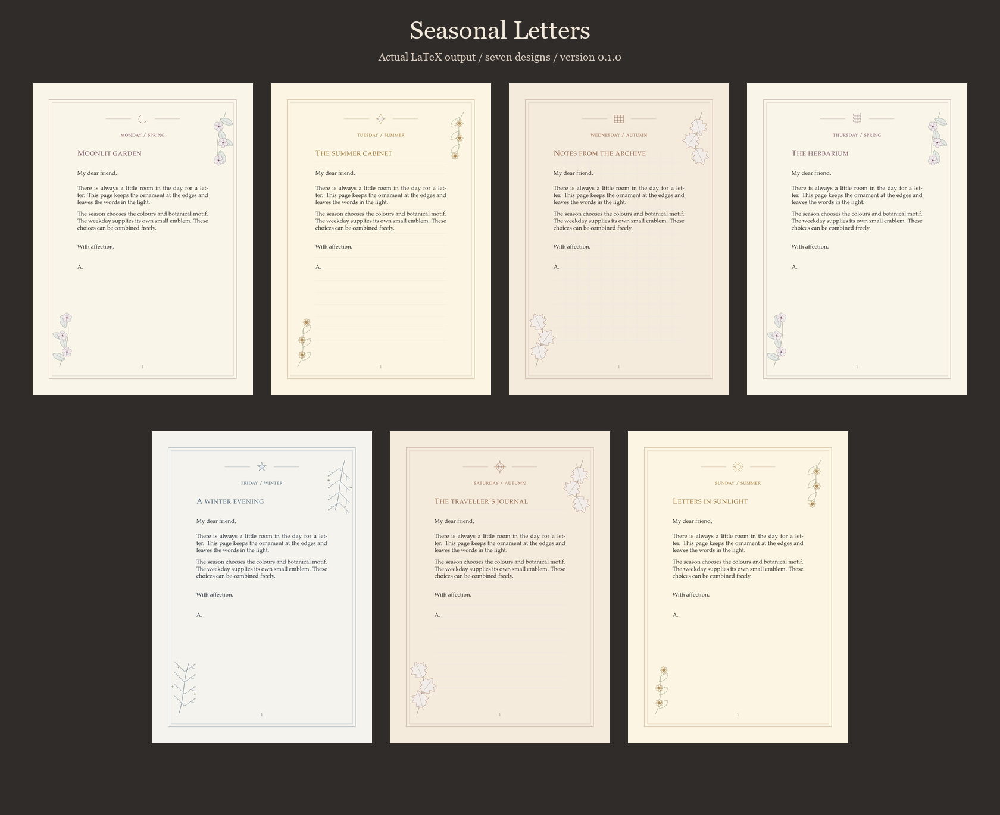

# Seasonal Letters

Configurable decorative stationery for LaTeX, by aqsa.

[Visit the website, gallery and quick-start guide](https://aqsa48.github.io/seasonsletters/)

Seasonal Letters keeps letter content separate from page decoration. Combine
four seasonal palettes and original vector botanical motifs with seven weekday
emblems. First pages can carry a full design while continuation pages use a
quieter border. User images can be added without editing the package source.

## What it solves

- Reuse the same letter with different stationery settings.
- Let paragraphs flow onto continuation pages without fixed-height text boxes.
- Choose plain, ruled, or grid paper and a white-paper, ink-saving print mode.
- Define named themes and add your own corner artwork or paper background.
- Keep the runtime small: no bundled image collection, proprietary fonts, or
  shell-escape requirement.

The built-in artwork is clean vector line art inspired by old stationery.
Painterly concept images from the design discussion are not package assets.
Weekday and season are explicit settings, not inferred from the date.

## Start here

Copy seasonalletters.sty and seasonalletter.cls beside this file:

~~~tex
\documentclass[a4paper]{seasonalletter}
\SeasonalSetup{season=autumn,weekday=wednesday,paper=grid}
\begin{document}
\begin{SeasonalLetter}
\SeasonalHeading{From the reading room}
\SeasonalOpening{Dear friend,}
Your letter goes here. It can continue naturally over several pages.
\SeasonalClosing{With warm wishes,}{Alex}
\end{SeasonalLetter}
\end{document}
~~~

Compile twice with pdfLaTeX, XeLaTeX, or LuaLaTeX. The package uses the LaTeX
2020-10-01 shipout hooks. TikZ/PGF, graphicx, and etoolbox are required. The
optional class also uses geometry, fontenc, and mathpazo. No system fonts or
external images are needed. Standard TeX Live and MiKTeX installations can
provide these dependencies; this package is not yet claimed to be in either.

## Examples and documentation

- [Manual](seasonalletters-doc.pdf): full option reference and extension guide.
- [Seven-design gallery](seasonalletters-gallery.pdf): seven independent
  season/day combinations on A5 sheets.
- [Two-page letter](seasonalletters-example.pdf): first and continuation pages.
- [Print mode](seasonalletters-print.pdf): US Letter, white paper and grey art.
- [Standard letter class](seasonalletters-standard.tex): preserves normal letter
  commands and address layout.

Use the package with an existing class via:
~~~tex
\usepackage[season=winter,weekday=friday]{seasonalletters}
~~~
It does not change that class's margins, font, addresses, or letter commands.
Call \SeasonalReset before each new letter to restart first-page decoration.
Read the manual's integration notes before using postal-window layouts.

## Build and verify

With Python 3, pypdf, pdfplumber, and a TeX installation:

~~~sh
python tools/build.py --engine pdflatex
python tools/build.py --engine xelatex
python tools/build.py --engine lualatex
python tools/package.py
~~~

The build uses a disposable directory, compiles examples and regression cases,
and exports the user-facing PDFs into the repository root. Verification of PDF
page sizes and text boundaries needs Python's pypdf and pdfplumber. Portable
Tectonic is supported with --engine tectonic --executable /path/to/tectonic.
See [VALIDATION.md](VALIDATION.md) for checks actually run for this release.

## Customisation

~~~tex
\SeasonalDeclareTheme{archive}{
  season=autumn,weekday=saturday,paper=ruled,
  border=single,accent=brown!70!black}
\SeasonalSetup{theme=archive,output=print}
~~~

The guide/ruling inset keys describe the writing rectangle; they do not change
the document's geometry. The optional class provides suitable margins. The
package does not validate tagged PDF/PDF-UA output, infer local seasons, or
mirror decoration for book binding.

## Licence and contact

Copyright (c) 2026 aqsa. MIT License; see [LICENSE](LICENSE). This covers the
package, class, original vector art, examples, manual, and development scripts.
No third-party artwork or font files are bundled. Dependencies retain their
own licences.

Repository: https://github.com/Aqsa48/seasonsletters

Report issues: https://github.com/Aqsa48/seasonsletters/issues

Maintainer: aqsa <aqsa.umar3505@gmail.com>.
